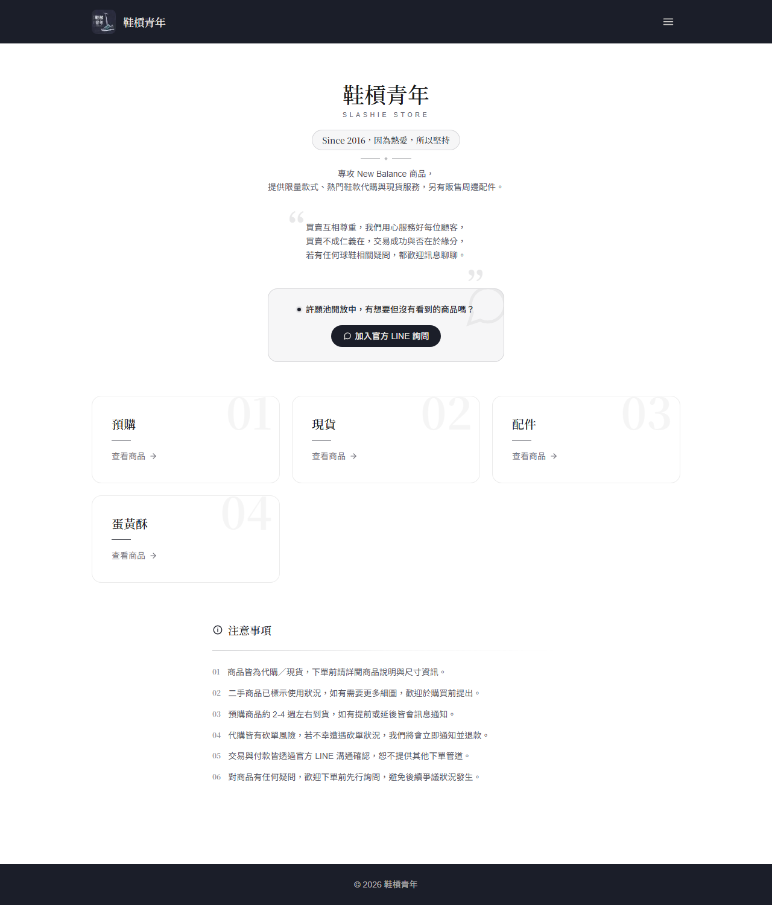
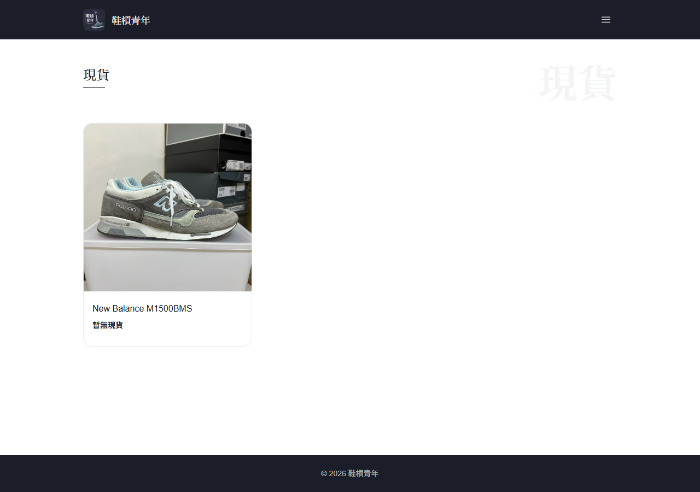
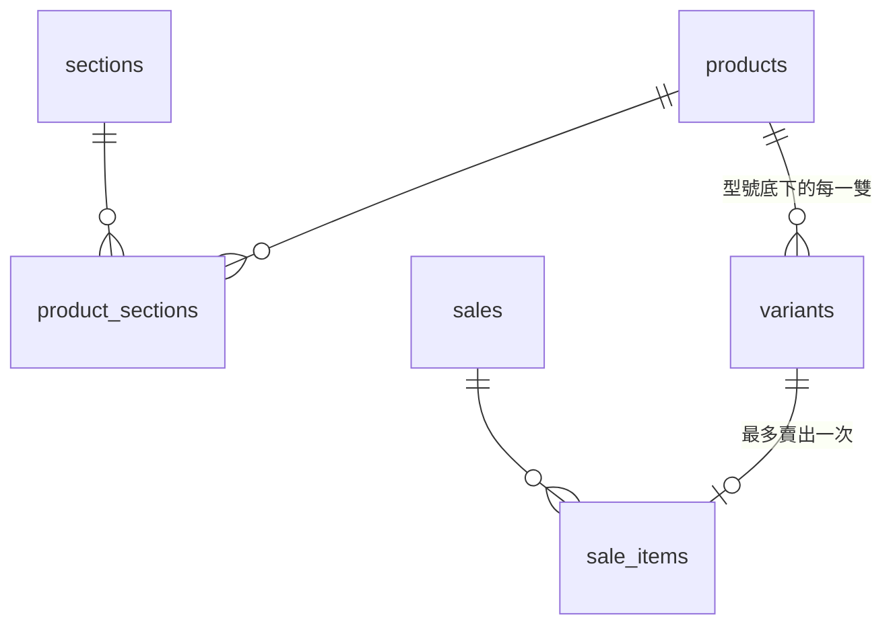

# Slashie Store — 鞋槓青年 球鞋代購與現貨商店

為球鞋代購小店「鞋槓青年」打造的商品型錄網站與後台管理系統。
前台讓顧客瀏覽預購、現貨（全新／二手）與配件，透過 LINE 直接詢問下單；
後台把店主原本散落在 Excel 與聊天紀錄裡的**入庫 → 上架 → 銷售 → 利潤**流程整合成一套工具。

**線上版：** [slashie-store.vercel.app](https://slashie-store.vercel.app)（後台需登入）




---

## 要解決的問題

小型球鞋代購店的日常營運有幾個特性，一般電商平台不容易處理：

- **同一型號，每一雙都不一樣：** 全新現貨可以用數量管理，但二手鞋每雙的鞋況、盒況都不同，
  預購則是每個名額各自獨立，不能合併成「庫存 3 雙」。
- **交易在 LINE 上完成：** 顧客習慣私訊詢問、議價，網站只需要展示商品，並把詢問帶到 LINE。
- **店主需要知道賺多少：** 每雙鞋的進貨成本不同，賣出後要能算出實際利潤。
- **分類常常變動：** 除了預購／現貨／配件，有時候會臨時開團（例如節慶商品），分類不能寫死在程式裡。

## 功能

### 前台

- **動態分類頁：** 首頁的分類卡片與導覽選單都由資料庫產生，後台新增分類後前台立即出現。
- **商品列表：** 顯示封面、品牌、最低價（「NT$ x 起」），沒有可售品項時顯示「暫無現貨」。
- **商品詳情：** 依「現貨新品／現貨二手／預購代購」分組列出所有規格，每個規格有自己的尺寸、價格、鞋況說明與照片；
  切換規格時照片跟著切換，可點縮圖或開啟全螢幕 lightbox（支援鍵盤左右鍵）。
- **LINE 詢問：** 「LINE 詢問」按鈕會自動帶入商品名稱、尺寸與類型的預填訊息，顧客不用自己打字說明要哪一雙。
- **許願池：** 首頁引導顧客透過官方 LINE 提出想要但目前沒有的商品。

### 後台（`/admin`，需登入）

| 頁面 | 用途 |
| --- | --- |
| **庫存管理** | 快速入庫：登記型號、新品／二手、尺寸、鞋況、盒況配件、成本與實品照片。入庫後預設**不上架** |
| **商品管理** | 補上品牌、描述、售價，勾選要出現在哪些分類，並切換上架狀態 |
| **分類管理** | 新增、排序、啟用／停用分類，網址代號（slug）可自訂 |
| **銷售管理** | 從未售出的庫存中挑選品項成交，記錄金額、買家、寄件管道（面交、Shopee、7-11 店到店、7-11 賣貨便、郵局宅配）與寄件編碼，**自動計算利潤** |



## 設計重點

### 資料模型：型號 × 品項



- **products（型號）** 是展示單位；**variants（品項）** 才是實際的庫存單位，記錄類型、尺寸、鞋況、盒況、售價、成本、照片與狀態。
- 資料庫層用 `CHECK` constraint 保證**只有全新現貨可以有多件數量**，二手與預購一律 `quantity = 1`，避免把不同鞋況的鞋誤合併。
- 商品與分類是多對多（`product_sections`），同一雙鞋可以同時出現在「現貨」與某個活動分類。
- `sale_items.variant_id` 設為 `unique`，同一個品項不可能被賣兩次。

### 狀態流轉：沿用既有欄位，不另開狀態表

品項的生命週期只用一個 `status` 欄位（`hidden` / `available` / `sold`）表達：

```
入庫（hidden）──上架──▶ 販售中（available）──成交──▶ 已售出（sold）
       ▲                                              │
       └──────────────── 刪除銷售紀錄 ─────────────────┘
```

- 成交時，品項改為 `sold`，所屬商品自動下架；後台列表以刪除線顯示，並從可售清單中排除。
- 刪除銷售紀錄時，品項自動回到 `hidden`、商品重新上架，**操作可以完整還原**。

### 資料安全：Row Level Security

| 角色 | 可以做什麼 |
| --- | --- |
| 匿名訪客 | 只能讀取**上架中**的商品、**非隱藏**的品項與**啟用中**的分類 |
| 登入的管理員 | 新增、修改、刪除所有資料，並上傳商品照片 |

成本與銷售紀錄（買家姓名、寄件編碼）只開放給已登入的帳號讀取；即使有人拿到前台使用的 anon key，也無法查詢這些資料。
後台路由另由 Next.js proxy（原 middleware）檢查 Supabase session，未登入時自動導向登入頁。

### 隨需求演進的 Schema

[`supabase/migrations/`](supabase/migrations/) 保留了 12 個 migration，記錄系統如何跟著實際營運調整，包含**加入後又移除**的功能：

| Migration | 變更 |
| --- | --- |
| 0001–0003 | 初始 schema、範例資料、後台權限與圖片儲存空間 |
| 0004、0007 → 0008 | 加入 LINE 詢問單與訂單追蹤，實際使用後發現店主仍習慣在 LINE 處理，**整個移除** |
| 0005 | 把寫死的三種分類改為後台可管理的動態分類，並搬移既有資料 |
| 0006、0010 | 庫存管理：成本、盒況配件 |
| 0009 | 移除預購批次概念，直接以品項管理 |
| 0011–0012 | 銷售管理與寄件管道 |

### 其他細節

- **Supabase keepalive：** 免費方案的專案閒置 7 天會被暫停，[GitHub Actions](.github/workflows/supabase-keepalive.yml) 每天呼叫一次 REST API 維持運作。
- **On-demand revalidation：** 後台每次寫入後以 `revalidatePath` 更新前台頁面，不需要等快取過期。
- **未設定環境變數時不會壞掉：** 缺少 Supabase 設定時顯示設定說明頁，而不是錯誤畫面。

## 架設與開發

**需要：** Node.js 20 以上、一個免費的 [Supabase](https://supabase.com) 專案。

1. 到 Supabase 的 **SQL Editor** 依序執行 [`supabase/migrations/`](supabase/migrations/) 內的所有檔案（`0002_seed.sql` 為範例資料，可略過）。
2. 到 **Authentication → Users** 建立管理員帳號，並關閉公開註冊。
3. 在專案根目錄建立 `.env.local`：
   ```bash
   NEXT_PUBLIC_SUPABASE_URL=...        # Supabase Project URL
   NEXT_PUBLIC_SUPABASE_ANON_KEY=...   # Supabase anon key
   NEXT_PUBLIC_LINE_URL=...            # 官方 LINE 連結（選填）
   NEXT_PUBLIC_INSTAGRAM_URL=...       # Instagram 連結（選填）
   NEXT_PUBLIC_SITE_URL=...            # 正式網址，用於 Open Graph（選填）
   ```
4. 啟動：
   ```bash
   npm install
   npm run dev     # http://localhost:3000，後台在 /admin
   ```
5. **部署：** 在 [Vercel](https://vercel.com) 匯入此 repo，設定同樣的環境變數；
   若要啟用 keepalive，在 GitHub repo 的 Secrets 加入 `SUPABASE_URL` 與 `SUPABASE_ANON_KEY`。

## 專案結構

```
src/
  app/
    page.tsx                  首頁：品牌介紹、分類卡片、注意事項
    [slug]/                   動態分類頁
    products/[id]/            商品詳情、規格選擇、照片 lightbox、LINE 詢問
    admin/
      actions.ts              所有後台寫入操作（Server Actions）
      inventory/              庫存管理
      products/               商品管理與編輯表單
      sections/               分類管理
      sales/                  銷售管理與利潤計算
      login/                  管理員登入
  components/                 共用元件（商品網格、漢堡選單、載入狀態）
  lib/
    queries.ts                資料查詢
    types.ts                  型別與常數
    product-image.ts          封面與相簿圖片的 fallback 邏輯
    supabase/                 Supabase client（browser / server / proxy）與圖片上傳
  proxy.ts                    後台路由保護
supabase/migrations/          資料庫 schema 演進紀錄
.github/workflows/            Supabase keepalive
docs/screenshots/             README 使用的截圖
```

## 已知限制與未來規劃

- 成交、品項狀態更新、商品下架目前是三次獨立的寫入，尚未包成單一 transaction（可改用 Postgres RPC）。
- 全新現貨若一筆品項的數量大於 1，成交時會整筆標為已售出；目前實務上每筆入庫都是一雙，尚未處理部分售出。
- 銷售報表：依月份統計營收、利潤與庫存週轉天數。
